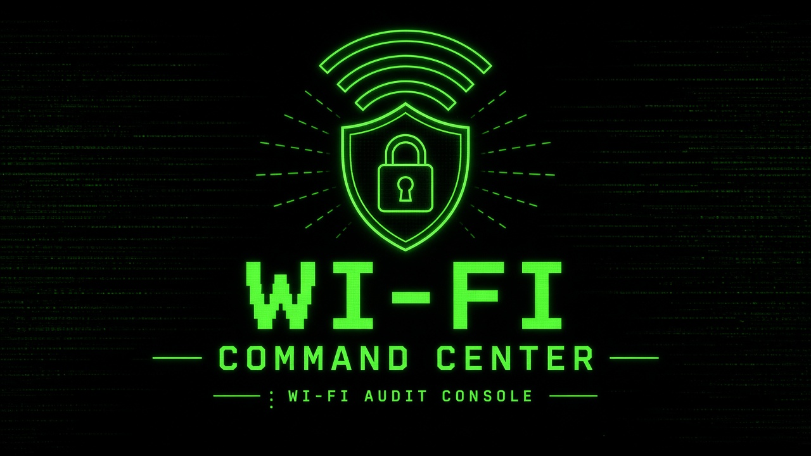
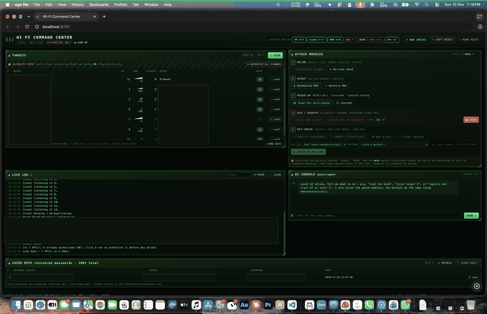

<p align="center">
  
</p>

<h1 align="center">Wi-Fi Command Center</h1>

<p align="center">
  <b>A local, authorized Wi-Fi security-audit console.</b><br>
  A browser dashboard on your Mac that drives a Kali Linux VM as the radio,<br>
  cracks on your Mac GPU, and is operated by a <b>local AI model</b> — no cloud.
</p>

<p align="center">
  
  
  
  
</p>

> ⚠️ **EDUCATIONAL / AUTHORIZED TESTING ONLY.** Use this **only** on networks you own or are explicitly authorized to test. Every attack action is gated by an allowlist you fill in yourself. Attacking networks you don't own is illegal in most countries. See [DISCLAIMER.md](DISCLAIMER.md).

---

## The console

<p align="center">
  
</p>

> _All BSSIDs, MAC addresses, network names and recovered keys are redacted in these images. The lab was run on the author's own equipment._

## What it is

A single dashboard that ties together the standard Wi-Fi audit workflow, with three ideas that make it different from a plain `aircrack-ng` GUI:

- **Split architecture** — your Mac is the controller + GPU cracker + UI; a Kali VM is just the antenna.
- **Allowlist safety gate** — no capture, deauth, WPS, or PMKID action runs against a BSSID that isn't in your `authorized-targets.txt`. The backend enforces it.
- **Local-AI operator** — a local LLM (via Ollama) runs the tools and teaches *why* each step works and how to defend against it. 100% offline.

## Modules

| Module | What it does |
|---|---|
| **Scan** | Passive 2.4 GHz sweep — lists nearby APs + clients |
| **Capture** | Grab a WPA2 handshake (needs a connected client) |
| **PMKID** | Clientless capture path |
| **Crack** | Tiered **Mac-GPU** crack (hashcat Metal) — weak-pins → wordlists → masks |
| **Triage** | Inspect a capture before cracking |
| **Deauth** | Targeted (one client) or broadcast — bounded + stoppable |
| **WPS** | `wash` → Pixie-Dust |
| **Rogue-AP** | **Detector only** — flags a twin of your SSID (defensive) |
| **Adapter Doctor** | Self-heals the USB Wi-Fi adapter |

Every module ends with its **one-line defense** — the point of the lab is to learn how to *protect* against each attack.

## Architecture

```
  ┌─ Your Mac ──────────────┐        ┌─ Kali VM (UTM) ─────────┐
  │  Dashboard (browser)    │        │  the "radio"            │
  │  FastAPI backend ───────┼──ssh──▶│  USB Wi-Fi adapter      │
  │  GPU cracker (hashcat)  │        │  (monitor + injection)  │
  │  Local AI (Ollama)      │        └─────────────────────────┘
  └─────────────────────────┘
```

## Quick start

1. **Kali VM** with a monitor-mode USB Wi-Fi adapter passed through (see [docs/SETUP-WIFI-LAB.md](docs/SETUP-WIFI-LAB.md)).
2. **Backend:**
   ```bash
   cd command-center/backend
   python3 -m venv .venv && . .venv/bin/activate && pip install -r requirements.txt
   uvicorn app:app --host 127.0.0.1 --port 8787
   ```
3. Open **http://localhost:8787**.
4. **Authorize your own targets** in the Targets panel (copy `config/authorized-targets.example.txt` to `wifi-lab/authorized-targets.txt` and add only BSSIDs you own).
5. **Local AI** (optional operator + tutor): see [docs/SETUP-LOCAL-AI.md](docs/SETUP-LOCAL-AI.md) — model picks by RAM, from 4 GB laptops to 36 GB+ workstations.

## Local AI

The dashboard can be driven by a local LLM through Ollama — it operates the tools and explains each step. The setup guide picks a model to match your RAM (4 GB → 36 GB+) and includes a self-improving **skill tree** so the agent doesn't forget what it learns. See [docs/SETUP-LOCAL-AI.md](docs/SETUP-LOCAL-AI.md).

## License

[MIT](LICENSE) — for educational and authorized-testing use. You are responsible for how you use it.
